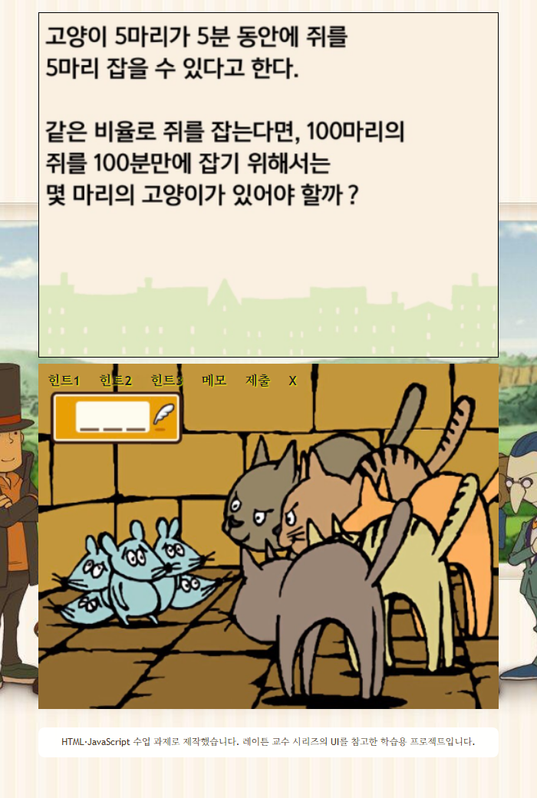

# 레이튼 스타일 수수께끼

레이튼 교수 시리즈의 화면 구성을 참고해 만든 HTML·JavaScript 수업 과제입니다. 별도 설치 없이 브라우저에서 수수께끼를 풀고, 화면 위에 메모를 그릴 수 있습니다.

## 사용 방법

1. 위 체험 버튼을 누르고 화면의 문제를 읽습니다.
2. 도움이 필요하면 **힌트 1~3**을 선택합니다.
3. 문제 화면을 마우스나 손가락으로 드래그해 메모합니다. **메모 → 모든 라인 지우기**로 지울 수 있습니다.
4. **제출** 탭에 숫자로 정답을 입력하고 **정답 확인**을 누릅니다.
5. **X**는 열린 탭을 닫습니다.

## 구현

- HTML·CSS: 문제 화면과 탭 UI, 작은 화면에 맞춘 크기 조정
- JavaScript: 힌트 탭 전환, 정답 확인과 해설
- Canvas·Pointer Events: 마우스·터치 메모와 지우기
- GitHub Pages: 정적 파일 배포, 방문자의 브라우저에서 실행

외부 라이브러리와 별도 서버 없이 동작합니다. 로컬에서는 `index.html`을 브라우저로 열면 됩니다. 예전 파일명인 `semester_homework.html`도 체험 화면으로 연결됩니다.

## 참고 및 권리

레이튼 교수 시리즈의 UI와 이미지를 참고한 비공식 학습용 프로젝트입니다. 게임 관련 이미지의 권리는 원저작권자에게 있으며, 공식 게임과 관련이 없습니다.
